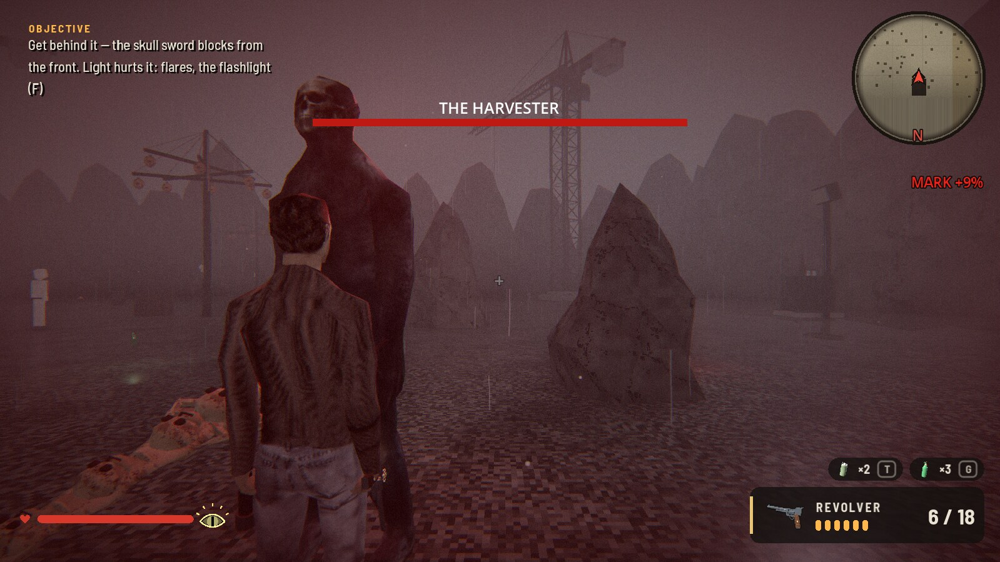
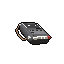
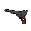
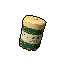
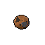
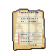
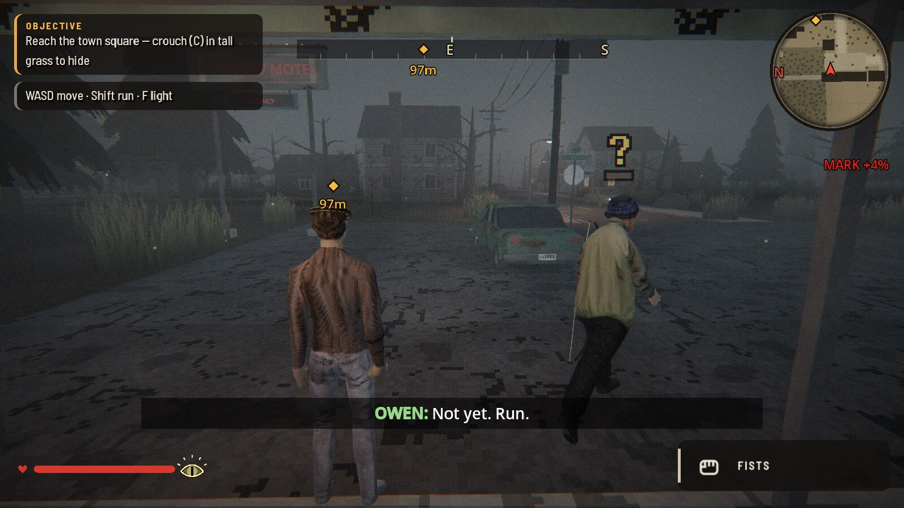
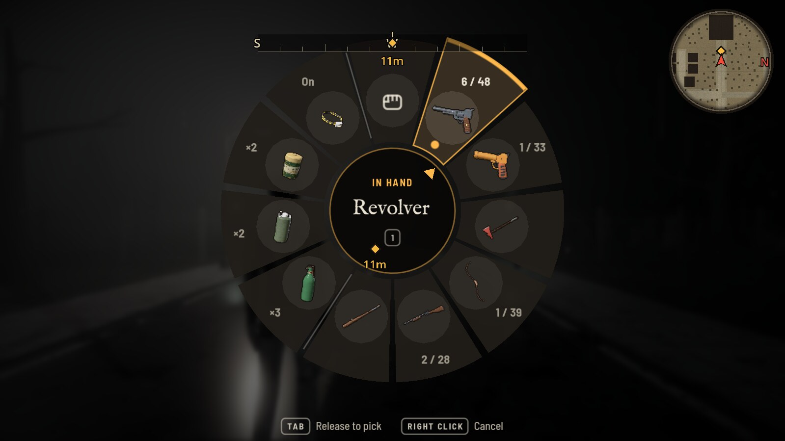
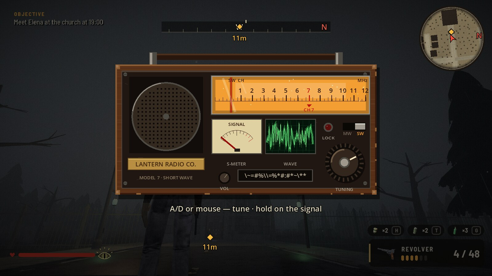
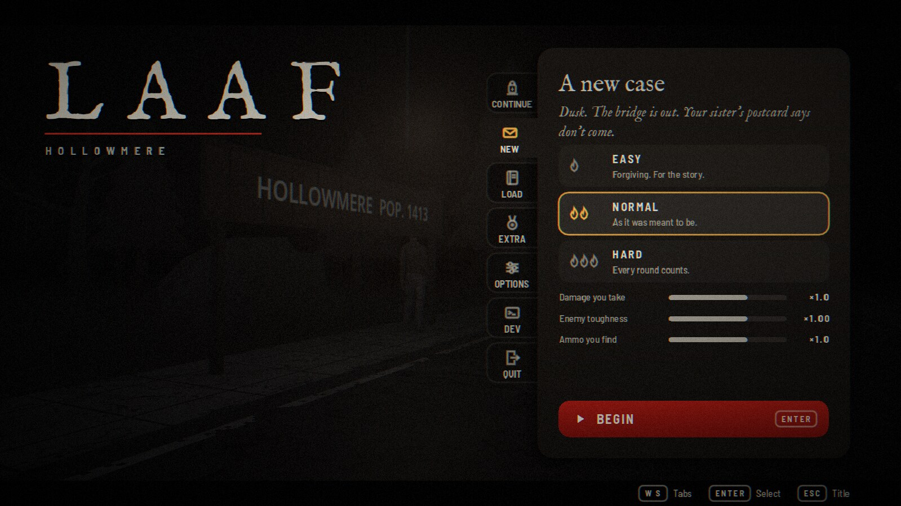

<div align="center">

# LAAF

### A fog-bound town. A mark on your hand. Five old friends hunting you.

A short third-person survival horror game for Windows and Linux, with the look
of the PSX/PS2 era and an interface built to modern standards. Find your missing
sister, decide who lives, and try to leave Hollowmere.

[](https://github.com/Juan17la/laaf_game/releases/latest)
[](#download)
[](https://godotengine.org)

[Download](#download) · [How it works](#how-it-works) · [Controls](#controls) · [Documentation](#documentation) · [Run from source](#run-from-source)

<br />



</div>

<br />

## What is LAAF?

Alex drives into the lake town of Hollowmere looking for their missing sister,
Lucía. On the first night a shape at the motel window brands Alex's hand with
the Veil's Eye. Five childhood friends serve the cult behind it, and each one
hunts a part of the town. One of them secretly helps Alex over the radio, until
the others find out.

There are three chapters of about 10 minutes each on the critical path, or
30 to 45 minutes in total with the optional content. You can finish it in one
evening and replay it for the other endings.

<br />

## What you can do

<table>
<tr>
<td width="50%" valign="top">



**Hide or run**

Noise and light give you away. Crouch in tall grass, throw a bottle to draw
attention, or drop a smoke can to block their sight.

</td>
<td width="50%" valign="top">



**Fight when you have to**

Fists, fire axe, nail bat, revolver, flare gun, shotgun and a hunting bow.
Swap and fire within 0.45 s for a +50% double tap.

</td>
</tr>
<tr>
<td valign="top">


**Beat each hunter their own way**

Every boss has a weakness to work out. Fire stuns Owen, and Marcus takes the
church bells on his head.

</td>
<td valign="top">



**Live with your choices**

Spare or kill each defeated hunter. That decides who stands with you in the last
fight and which of the five endings you get.

</td>
</tr>
<tr>
<td valign="top">



**Take a break, if you dare**

Lockpicking, radio tuning, a shooting gallery, fishing, a card game against
Silas and an arcade cabinet with a hidden message.

</td>
<td valign="top">



**Read the case file**

12 pieces of evidence and 13 achievements, then a final report on how you played:
time, accuracy, deaths and your habits.

</td>
</tr>
</table>

<br />

## A quick look

<table>
<tr>
<td width="50%"></td>
<td width="50%"></td>
</tr>
<tr>
<td align="center"><sub>The first hunt: Owen's voice, an alert, and the Mark rising</sub></td>
<td align="center"><sub>Hold Tab: time slows and the wheel opens</sub></td>
</tr>
<tr>
<td></td>
<td></td>
</tr>
<tr>
<td align="center"><sub>Radio tuning, one of six minigames</sub></td>
<td align="center"><sub>Every menu is a dossier laid over the live town</sub></td>
</tr>
</table>

<br />

## How it works

```
Explore ─► get hunted ─► hide or escape ─► fight when forced ─► decide each hunter's fate
   ▲                                                                       │
   └──────────── new mission step, new zone, new mechanic ◄────────────────┘
```

**The Mark is the clock on your run.** It goes from 0 to 100%, rising at night
and whenever Alex is seen or caught. The higher it climbs, the more the town
turns on you:

| Mark | What happens |
|------|--------------|
| 25% | Whispers start |
| 50% | Hunters can sense you |
| 70% | You start seeing things |
| 100% | You are taken |

Elena's tea lowers it by 15%. Your exact Mark is shown in the pause menu.

**Each chapter follows the same shape:** an opening cinematic, the main missions,
optional side missions and minigames, a hunter or boss fight, then a closing
cinematic.

| Chapter | Where | Who hunts you |
|---------|-------|---------------|
| I. The Mark | Bridge, motel, forest edge, square, sawmill | Owen |
| II. Moth | Harbor, lighthouse, school, clinic | Nora and Julian, in either order |
| III. The Harvest | Cemetery, church, lighthouse, quarry, chapel | Marcus, then The Harvester |

**The game saves for you** at every mission step, and you can save by hand from
the pause menu. There are three difficulties, which change the damage you take,
how tough enemies are and how much ammo you find.

<br />

## Controls

Keyboard and mouse first. Gamepad is supported, and on-screen prompts always show
the key to press. Keys can't be rebound yet.

| Action | Key | | Action | Key |
|--------|-----|-|--------|-----|
| Move | `WASD` or arrows | | Fire / aim | Left / right mouse |
| Run | `Shift` | | Reload | `R` |
| Crouch | `C` | | Melee | `B` |
| Roll | `Ctrl` | | Swap weapon | `Q` or `1`–`6` |
| Jump | `Space` | | Selection wheel | Hold `Tab` |
| Interact | `E` | | Throw bottle | `G` |
| Flashlight | `F` | | Smoke can | `T` |
| Shoulder swap | `V` | | Drink tea | `H` |
| Inventory | `I` | | Gas mask | `X` |
| Map | `M` | | Pause | `Esc` |

<br />

## Download

Get the newest version from the [Releases page](https://github.com/Juan17la/laaf_game/releases/latest).

| System | File to pick | How to install |
|--------|--------------|----------------|
| Windows 10 and 11 | `LAAF-<version>-windows-setup.exe` | Run it. It isn't code-signed, so SmartScreen may warn you: choose *More info*, then *Run anyway* |
| Linux (x86-64) | `LAAF-<version>-linux.tar.gz` | Extract it and run `./install.sh`, which adds LAAF to your app menu and a `laaf` command |

Your saved games are kept if you uninstall.

<br />

## Good to know

- **Mature content.** LAAF has horror and violence, and is meant for adults.
- **Languages.** English and Spanish, for both text and subtitles.
- **Comfort options.** Camera shake, hit-stop and screen effects can be turned
  down or off, and subtitles can be made larger.
- **One network call.** When the story ends, the game sends that run's numbers to
  [Groq](https://groq.com) to write a closing paragraph about how you played,
  labelled on screen as AI-written. It doesn't send your name or your saves. If
  it can't connect, you get a built-in line instead.

<br />

## Documentation

| I want to... | Read |
|--------------|------|
| See the full specification: features, requirements, use cases, architecture | [Project documentation](docs/project-documentation.md) |
| See the UI mockups, design system and navigation flow (open in a browser) | [Design planning](docs/design-planning/mockups.html) |
| Read the product brief: users, purpose, principles | [PRODUCT.md](PRODUCT.md) |
| Check the design system as built: tokens, components, rules | [DESIGN.md](DESIGN.md) |
| Read the game design: story, characters, map, chapters (English and Spanish) | [Game design docs](maps/docs/requirements.md) |

<br />

## Run from source

1. Install **Godot 4.7** (the editor, standard build).
2. Open `project.godot` in the editor (Import, then select the folder).
3. Press **F5**. The game boots into the main menu (`maps/main_menu.tscn`).

Developer shortcuts (command line, after `--`):

```sh
godot --path . -- --chapter=2          # start at a chapter
godot --path . -- --step=marcus        # start at a mission step
godot --path . -- --mark=60            # start with the Mark at 60 %
godot --path . --language es           # force Spanish
```

The main menu's **DEV** tab offers the same jumps without the command line. Dev
runs are never saved and never unlock achievements.

### Final report text

The closing text comes from Groq when a key is set, and otherwise from a built-in
set. In development, set the key in the `GROQ_API_KEY` environment variable or in
`user://groq_key.txt`. `installer/build.sh` packs that key into release builds
through a gitignored file that it deletes afterwards. Never commit the key. Anyone
who has a release can extract it, so use a key with limits you can afford and
replace it if it's abused. With no key, the game makes no network calls.

To test the AI text without finishing the game, use **AI result** in the main
menu's DEV tab. It makes up a random run, sends it to Groq and shows the report.
If the call fails, the report says why.

### Tests

Headless test scenes live in `tests/` (`*_test.gd`). They cover the chapters,
combat, saving, the inventory, the menus' mouse handling, localization, minigames
and more. Run one with:

```sh
godot --headless --path . --script tests/save_test.gd
```

### Building the installers

```sh
installer/build.sh        # needs Godot 4.7 export templates; makensis for the Windows installer
```

This produces `build/LAAF-<version>-windows-setup.exe` and
`build/LAAF-<version>-linux.tar.gz`.

### Project layout

```
maps/        scenes (main menu, the town Hollowmere) and the design docs (maps/docs)
player/      the player controller, weapons, HUD, weapon wheel, screen effects, minimap
scripts/     game flow (game.gd), chapter directors, enemies, menus, minigames, settings, audio
shaders/     the PS2 post-process, the menu CRT pass, pause blur, wheel grey
ui/icons/    rendered item icons used by the HUD, the wheel and the inventory
fonts/       IM Fell English and Barlow Semi Condensed (OFL)
locale/      translations (laaf.pot, es.po) and the glossary
models/, audio/, Characters_psx_02/   art and sound assets
tools/       asset build scripts (Blender/Python), screenshot and icon renderer, l10n tooling
tests/       headless tests
installer/   export and installer scripts
```

<div align="center">
<br />
<sub>Made by Juan Diego López Arias</sub>
</div>
